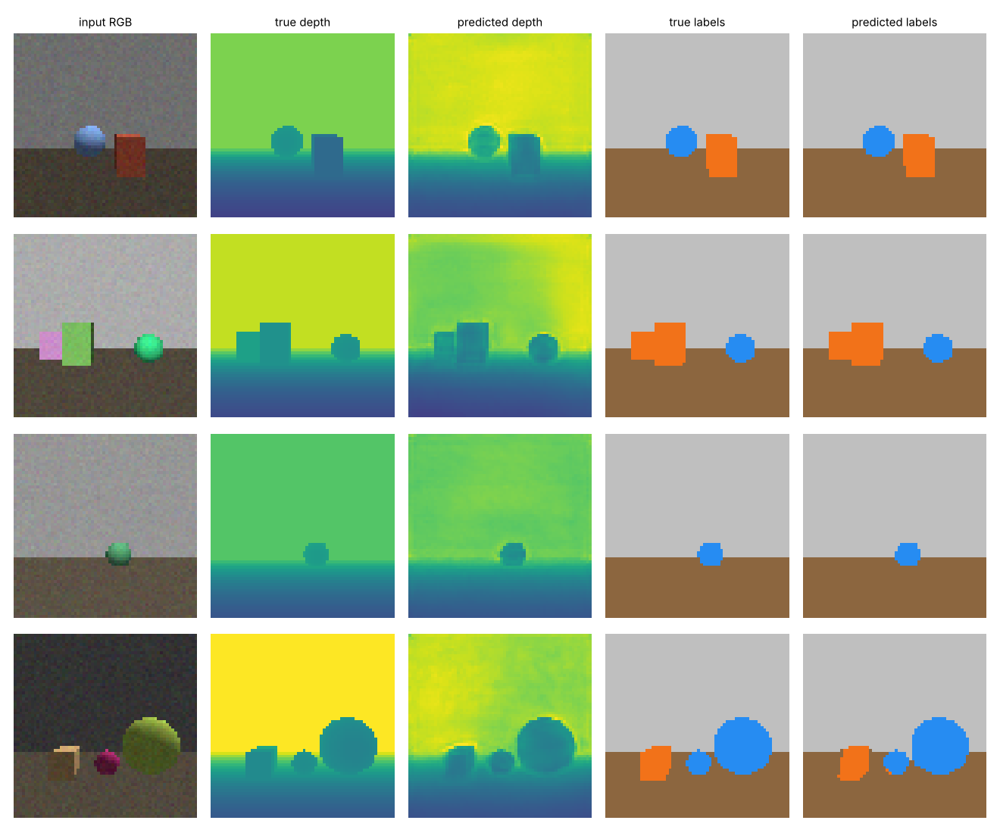
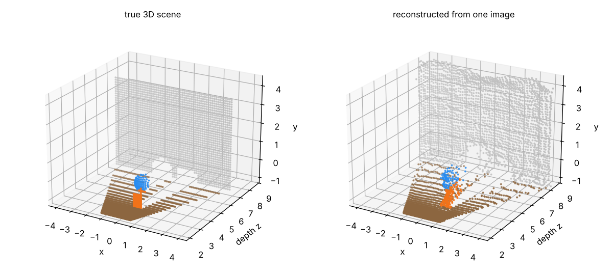

# Single-Image Semantic 3D Reconstruction

From **one RGB image**, a PyTorch network predicts **per-pixel depth** and **semantic labels**. The depth map is back-projected through the camera model into a **3D point cloud**, coloured by class, and evaluated against the true 3D scene.




## Pipeline

1. **Synthetic RGB-D data** (`depth3d/scene.py`): a vectorised NumPy ray caster renders rooms (back wall, floor) with random spheres and boxes. Every pixel has exact ground-truth depth and a class label. Lambertian shading with a random light, plus sensor noise.
2. **Multi-task U-Net** (`depth3d/model.py`, 1.9 M parameters): shared encoder-decoder with skip connections and two heads, log-depth regression and 4-class segmentation. Object boundaries are also depth discontinuities, so the tasks help each other.
3. **Training** (`train.py`): L1 loss on log-depth + cross-entropy, AdamW with a one-cycle learning rate, horizontal-flip augmentation.
4. **3D reconstruction** (`depth3d/geometry.py`): pinhole back-projection of predicted depth into camera-space points; export to `.ply` (open in MeshLab, CloudCompare, Open3D, Blender).
5. **Evaluation**: standard monocular-depth metrics, mIoU, and the **Chamfer distance** between reconstructed and true point clouds, all on 300 held-out scenes and compared against a baseline.

## Results (300 held-out scenes, 64×64, CPU)

| Metric | Model | Baseline* |
|---|---|---|
| Depth AbsRel ↓ | **0.077** | 0.161 |
| Depth RMSE ↓ | **0.58** | 1.06 |
| δ < 1.25 ↑ | **97.7%** | 81.7% |
| Segmentation mIoU ↑ | **97.3%** | 43.2% |
| Pixel accuracy ↑ | **99.6%** | 88.8% |
| 3D Chamfer distance ↓ | **0.37** | 0.55 |

\*Baseline: the average training depth map and the per-pixel majority class. It already gets the room layout roughly right, so beating it shows the network actually reads the scene, not just the average room.

Depth error by class (AbsRel): wall 0.075, floor 0.072, sphere 0.103, box 0.105.

## What the results show (and where it fails)

- **Objects are harder than the room.** Spheres and boxes have ~40% higher depth error than wall and floor: they are small, and their distance must be inferred from where they touch the floor.
- **The blank back wall is ambiguous.** On average the wall depth bias is small (+1.8%), but in 25% of test scenes the wall is off by more than 10% (worst 26%). A textureless wall gives a single image almost no distance cue except the floor-wall line, which is exactly the scale ambiguity of monocular depth. The point-cloud figure shows one such scene: the wall is reconstructed too far back.
- **Segmentation is near-perfect** because colour and shape separate the classes cleanly in synthetic data. Real scenes would be much harder.

## Limitations

- Synthetic, low-resolution (64×64) data; no domain gap to real images was tested.
- Trained from scratch on CPU (~35 minutes, 25 epochs, 4 000 scenes); no pretrained backbone, no CUDA.
- Depth is learned up to the scale of these rooms; real scenes need scale-invariant losses or metric cues.

## Next steps

- Train on a real RGB-D dataset (e.g. NYU Depth V2) with a pretrained encoder, and measure the synthetic-to-real gap.
- Scale-invariant loss for depth; edge-aware smoothness to sharpen object boundaries.
- Fuse several views into one point cloud or mesh (e.g. TSDF fusion) for multi-view 3D reconstruction.
- Train on GPU with CUDA at higher resolution.

## Run

```bash
pip install -r requirements.txt
pytest -q                 # 9 tests: ray caster, geometry, model, metrics
python train.py --quick   # smoke test (~1 min)
python train.py           # full run, writes results/
python evaluate.py        # per-class error + 3D plot from the saved model
```

## Tests

- Ray caster: every sphere hit lies exactly on the sphere's surface; box front-face depth and normal; floor points back-project to a perfectly flat plane.
- Geometry: back-project then project returns the original pixel grid; PLY round trip; Chamfer distance.
- Model output shapes; metrics give perfect scores on perfect predictions.
